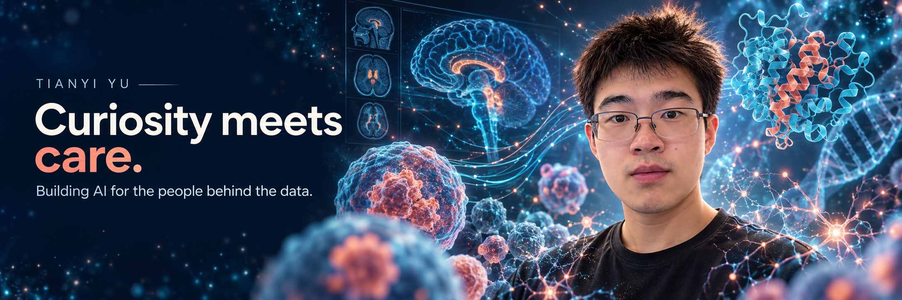

<a href="https://terry0809000.github.io/"><strong>Visit my website</strong></a> &nbsp; · &nbsp; <a href="https://terry0809000.github.io/projects.html"><strong>Explore the 12 projects</strong></a> &nbsp; · &nbsp; <a href="https://scholar.google.com/citations?user=m8F5KU8AAAAJ">Google Scholar</a> &nbsp; · &nbsp; <a href="https://orcid.org/0009-0009-0311-4015">ORCID</a>

I'm **Tianyi Yu**. I'm drawn to the stories hidden in clinical notes, the subtle signals in images, and the difficult questions behind a prediction.

I want to build AI that earns people's trust. My research explores how models behave when data are incomplete, populations change, and a good benchmark score meets the complexity of care. Here I share the code, questions and lessons along the way.

[About](https://terry0809000.github.io/about.html) · [Research](https://terry0809000.github.io/research.html) · [Projects](https://terry0809000.github.io/projects.html) · [Connect](https://terry0809000.github.io/connect.html)

### Research constellation

[Full-size mind map](https://github.com/terry0809000/research-portfolio/blob/main/figures/selected-projects-cosmos.png) · [Editable map and Mermaid source](https://github.com/terry0809000/research-portfolio/tree/main/figures) · [Research portfolio](https://github.com/terry0809000/research-portfolio)

AI-generated conceptual science-fiction background, with separately editable project labels and connections.

### Selected research

**12 projects across six connected directions.** Each project below links directly to its public code and documentation.

| Direction | Selected projects |
|:--|:--|
| **[Clinical NLP](https://terry0809000.github.io/projects-clinical-nlp.html)** · 3 projects | [Social and behavioural determinants from clinical text](https://github.com/terry0809000/MIMIC_SBDH) [Cross-corpus abstract classification](https://github.com/terry0809000/biomedical-abstract-sentence-classification) [Beyond Macro-F1](https://github.com/terry0809000/beyond-macro-f1-pubmed-rct-public) |
| **[Computer Vision](https://terry0809000.github.io/projects-biomedical-imaging.html)** · 2 projects | [Selective skin-lesion referral](https://github.com/terry0809000/ham10000-trustworthy-skin-ai) [MRI and clinical prediction of pathological complete response](https://github.com/terry0809000/breast-mri-response-prediction) |
| **[Trustworthy AI](https://terry0809000.github.io/projects-trustworthy-ai.html)** · 2 projects | [Measurement-aware ICU prediction](https://github.com/terry0809000/icu-measurement-aware-prediction) [Clinical prediction uncertainty and identification](https://github.com/terry0809000/clinical-uncertainty-identification) |
| **[Prediction Modelling](https://terry0809000.github.io/projects-prediction-modelling.html)** · 1 project | [Dynamic AKI prediction](https://github.com/terry0809000/aki-dynamic-prediction-deployment-gated) |
| **[Health Informatics](https://terry0809000.github.io/projects-health-informatics.html)** · 2 projects | [Six-hour ICU laboratory prediction](https://github.com/terry0809000/icu-six-hour-lab-prediction) [Eating disorder dynamics across everyday moments](https://github.com/terry0809000/eatingdisordermlvar) |
| **[AI for Health](https://terry0809000.github.io/projects-ai-for-health.html)** · 2 projects | [Sleep-EDF staging](https://github.com/terry0809000/sleepingedf) [Adaptive versus fixed smartwatch task acquisition](https://github.com/terry0809000/pads-adaptive-acquisition) |

The trustworthy AI selection connects reliability across hospitals and measurement patterns with the limits of what incomplete evidence can establish. The uncertainty and identification project uses exact calculations and explicitly synthetic simulations.

[Explore the selected projects on my website →](https://terry0809000.github.io/projects.html)

Statistical care. Reproducible code. Claims matched to evidence.
